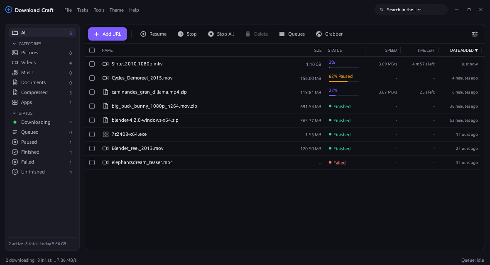
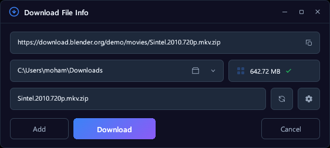

<div align="center">


# OpenDownloader

**A fast, modern, and offline-first download manager built in Rust — paired with an intelligent browser extension.**

Multi-connection dynamic acceleration, automated queue scheduling, YouTube and 1,000+ streaming sites via integrated yt-dlp & FFmpeg, dual MD5/SHA-256 checksum verification, and seamless browser hand-off.

[](https://github.com/Eaminx/OpenDownloader/releases/latest)
[](LICENSE)
[](https://www.rust-lang.org)
[](https://github.com/Eaminx/OpenDownloader/releases)

<br>



</div>

---

## 💡 About OpenDownloader

**OpenDownloader** was inspired by an earlier open-source Rust download manager concept whose original repository was untracked/unmaintained. Recognizing the immense potential of a native, lightweight Rust alternative to proprietary tools like Internet Download Manager (IDM), **OpenDownloader** represents an upgraded, modernized, and standalone evolution.

### 🌟 What's New & Upgraded in OpenDownloader

- **Dual Checksum Verification (MD5 + SHA-256):** Complete background streaming checksum verification supporting both 32-character MD5 and 64-character SHA-256 digests.
- **Smart Clipboard Hash Detection:** Automatically sniffs MD5/SHA-256 hashes from your clipboard when adding or pasting URLs and prepares verification upfront.
- **Audio Notifications & Chimes:** Integrated out-of-the-box audible feedback on download completion and error.
- **Modernized Media & Category Auto-Routing:** Expanded auto-categorization covering modern formats (`.heic`, `.flv`, `.m2ts`, `.opus`, `.aac`, `.xlsx`, `.pptx`, `.csv`, `.apk`, `.deb`, `.iso`, `.dmg`, etc.) into dedicated organized subfolders.
- **Browser Extension Right-Click Context Menus:** Right-click any link, video, or image directly in Chrome, Edge, Brave, or Firefox to download with OpenDownloader (full English & Bengali localization).
- **Hardened Architecture & Clean Re-Crating:** Standalone reusable engine crate (`crates/opendownloader-engine`), 100% test pass rate across 176 Rust tests and 158 extension tests.

---

## ⚡ Key Highlights

### 🚀 Dynamic Segmentation Engine
- **Dynamic Work Stealing (1–32 connections):** Idle connections split remaining byte-ranges in real time, preventing slow streams from throttling total transfer speed.
- **Single Pre-allocated File:** Eliminates the disk-intensive file-stitching phase at the end of downloads.
- **Crash-Safe Journaling:** Real-time state journaling flushes progress periodically, guaranteeing safe resume without corrupting partially downloaded bytes.
- **Remote ZIP Preview (`peek`):** Inspect contents of remote `.zip` archives without downloading the entire archive over the wire.

### 🎥 Video & Media Streaming
- Built-in integration for **yt-dlp** and **FFmpeg** with automatic updates.
- Supports 1080p, 4K, HLS (m3u8), and DASH streams with separate video and audio stream muxing.
- Direct downloads for Instagram, TikTok, Reddit, X (Twitter), Facebook, and Vimeo.
- Direct Google Drive large-file bypass and Docs/Sheets export support.

### 🌐 Browser Extension (Chrome, Edge, Brave, Firefox)
- **IDM-Style Hand-Off:** Pauses browser downloads, forwards authenticated session cookies, request headers, and proxy configs directly to the app.
- **On-Player Video Bar:** Floating *Download this video* pill on HTML5 video players with direct resolution and format selection.
- **Standalone Browser Mode:** Can also capture, mux, and save streams directly inside the browser when running without the desktop app.

---

## 📸 Screenshots

<table>
  <tr>
    <td width="55%" valign="top">
      
      <p><b>Download Confirmation</b> — Real-time filename, size inspection, category routing, and checksum staging.</p>
    </td>
    <td width="45%" valign="top">
      
      <p><b>Real-Time Progress</b> — Live transfer rate, ETA, dynamic segments, and per-connection status.</p>
    </td>
  </tr>
</table>

<p align="center">
  <br>
  <b>Floating Player Bar</b> — One-click download button directly overlaying web video players.
</p>

---

## 📦 Installation & Usage

### 🪟 Windows (Portable)
1. Download `OpenDownloader-0.9.10-windows-x64.zip` from [Releases](https://github.com/Eaminx/OpenDownloader/releases).
2. Extract the archive and launch `opendownloader.exe` — completely portable, no installer required!

### 🧩 Browser Extension Setup
1. **Chrome / Edge / Brave:**
   - Open `chrome://extensions` (or `edge://extensions`).
   - Enable **Developer mode** (top right).
   - Click **Load unpacked** and select the [`browser-extension`](browser-extension/) directory.
2. **Firefox:**
   - Open `about:debugging#/runtime/this-firefox`.
   - Click **Load Temporary Add-on…** and select `browser-extension/manifest-firefox.json`.
3. In the OpenDownloader app, open **Settings → Browser Integration** and click **Install** for your browser to activate Native Messaging.

---

## 🛠️ Building From Source

### Prerequisites
- [Rust](https://www.rust-lang.org/tools/install) (1.75+ recommended, MSVC tools on Windows)
- [Node.js](https://nodejs.org/) (for browser extension test suite)

```powershell
# 1. Clone the repository
git clone https://github.com/Eaminx/OpenDownloader.git
cd OpenDownloader

# 2. Build the optimized release binary
cargo build --release

# 3. Run all tests
cargo test --workspace

# 4. Run browser extension tests
cd browser-extension
node --test *.test.js
```

### 💻 CLI Usage
OpenDownloader shares its queue and settings between GUI and CLI:
```powershell
# Add a download
opendownloader.exe add "https://example.com/file.zip"

# Download directly in terminal
opendownloader.exe get "https://example.com/file.zip" -o "out.zip"

# Preview remote ZIP contents without downloading
opendownloader.exe peek "https://example.com/archive.zip"
```

---

## 📜 License & Credits

Distributed under the **MIT License**. See [`LICENSE`](LICENSE) for details.
All third-party fonts and components are documented in [`NOTICE.md`](NOTICE.md).
